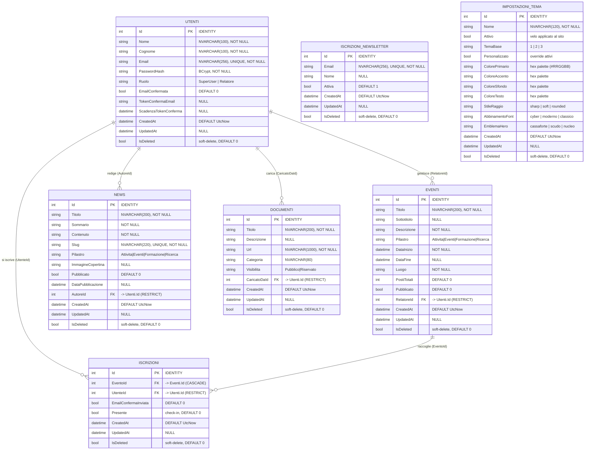

# DATABASE_ARCHITECTURE.md — Documentazione vivente dello schema FIDC

> 🔄 **DOCUMENTO VIVENTE / LIVING DOCUMENTATION**
> Questo file documenta lo schema reale del database FIDC.
> **REGOLA OBBLIGATORIA:** ogni volta che si altera la struttura del DB
> (nuova entità, colonna, FK, indice, migration EF) **si DEVE aggiornare**:
> 1. il diagramma **Mermaid ER** qui sotto,
> 2. la sezione tabelle interessata,
> 3. lo storico delle migration in fondo.
> La fonte di verità del modello resta `FIDC.Dal/FidcDbContext.cs` + le migration EF Core.

| Campo | Valore |
|-------|--------|
| Ultimo aggiornamento | 2026-11-27 |
| Migration corrente | `20260613231714_InitialCreate` |
| Provider supportati | **SQLite** (dev locale, default · `EnsureCreated`, file `fidc_dev.db`) · SQL Server 2019 (prod, via migration) · PostgreSQL (demo/Railway, via migration) |
| Sorgente del modello | `backend/FIDC.Dal/FidcDbContext.cs` |

---

## 1. Diagramma ER (Mermaid) — relazioni esatte



> ℹ️ `ISCRIZIONI_NEWSLETTER` è **standalone** (nessuna FK): ci si iscrive anche senza account.
> ℹ️ `IMPOSTAZIONI_TEMA` è **standalone** (nessuna FK): configurazione globale del "velo" del sito.

**Lettura del diagramma:**
- `UTENTI` 1 ── N `EVENTI`: un utente (Relatore) gestisce molti eventi (RBAC ownership).
- `UTENTI` 1 ── N `NEWS`: un utente redige molte news.
- `UTENTI` N ── N `EVENTI` tramite `ISCRIZIONI`: relazione molti-a-molti reificata (con attributi propri: presenza, email).

---

## 2. Tabelle in dettaglio

### 2.1 `Utenti`
Anagrafica account: staff di backoffice (SuperUser / Relatore) e utenti registrati dal sito.

| Colonna | Tipo (SQL Server) | Vincoli | Note |
|---------|-------------------|---------|------|
| `Id` | `INT IDENTITY` | **PK** | auto-incrementale |
| `Nome` | `NVARCHAR(100)` | NOT NULL | |
| `Cognome` | `NVARCHAR(100)` | NOT NULL | |
| `Email` | `NVARCHAR(256)` | **UNIQUE**, NOT NULL | è lo username |
| `PasswordHash` | `NVARCHAR(MAX)` | NOT NULL | BCrypt, mai in chiaro |
| `Ruolo` | `NVARCHAR(30)` | NOT NULL | enum salvato come stringa |
| `EmailConfermata` | `BIT` | DEFAULT 0 | |
| `TokenConfermaEmail` | `NVARCHAR(64)` | NULL | monouso (Resend) |
| `ScadenzaTokenConferma` | `DATETIME2` | NULL | TTL 48h |
| `CreatedAt` / `UpdatedAt` | `DATETIME2` | audit | popolati da `SaveChangesAsync` |
| `IsDeleted` | `BIT` | DEFAULT 0 | soft-delete (query filter globale) |

### 2.2 `Eventi`
Eventi della Federazione, di proprietà di un Relatore (RBAC).

| Colonna | Tipo | Vincoli | Note |
|---------|------|---------|------|
| `Id` | `INT IDENTITY` | **PK** | |
| `Titolo` | `NVARCHAR(200)` | NOT NULL | |
| `Pilastro` | `NVARCHAR(30)` | NOT NULL | enum `PilastroTipo` |
| `RelatoreId` | `INT` | **FK → Utenti.Id**, `RESTRICT` | non si elimina un relatore con eventi |
| `Pubblicato` | `BIT` | DEFAULT 0 | visibilità pubblica |
| *(+ audit/soft-delete)* | | | |

Indice: `IX_Eventi_Pubblicato_DataInizio (Pubblicato, DataInizio)`.

### 2.3 `News`
Articoli e comunicati, di proprietà di un autore.

| Colonna | Tipo | Vincoli | Note |
|---------|------|---------|------|
| `Id` | `INT IDENTITY` | **PK** | |
| `Slug` | `NVARCHAR(220)` | **UNIQUE**, NOT NULL | URL-friendly |
| `AutoreId` | `INT` | **FK → Utenti.Id**, `RESTRICT` | |
| `Pubblicato` | `BIT` | DEFAULT 0 | |
| *(+ audit/soft-delete)* | | | |

Indice: `IX_News_Pubblicato_DataPubblicazione (Pubblicato, DataPubblicazione)`.

### 2.4 `Iscrizioni` (pivot N:N)
Reifica la relazione molti-a-molti Utente ↔ Evento.

| Colonna | Tipo | Vincoli | Note |
|---------|------|---------|------|
| `Id` | `INT IDENTITY` | **PK** | |
| `EventoId` | `INT` | **FK → Eventi.Id**, `CASCADE` | eliminando l'evento, via le iscrizioni |
| `UtenteId` | `INT` | **FK → Utenti.Id**, `RESTRICT` | |
| `EmailConfermaInviata` | `BIT` | DEFAULT 0 | |
| `Presente` | `BIT` | DEFAULT 0 | check-in |
| *(coppia)* | | **UNIQUE (EventoId, UtenteId)** | niente doppie iscrizioni |

---

### 2.5 `Documenti` (Area Documenti)
Risorse scaricabili (report, linee guida, atti). Di proprietà di chi le carica (RBAC).

| Colonna | Tipo | Vincoli | Note |
|---------|------|---------|------|
| `Id` | `INT IDENTITY` | **PK** | |
| `Titolo` | `NVARCHAR(200)` | NOT NULL | |
| `Url` | `NVARCHAR(1000)` | NOT NULL | percorso/URL del file |
| `Categoria` | `NVARCHAR(80)` | | es. Report, Linee guida, Atti |
| `Visibilita` | `NVARCHAR(20)` | enum stringa | `Pubblico` (anonimi) / `Riservato` (backoffice) |
| `CaricatoDaId` | `INT` | **FK → Utenti.Id**, `RESTRICT` | owner RBAC |
| *(+ audit/soft-delete)* | | | |

### 2.6 `IscrizioniNewsletter`
Indirizzi iscritti alla newsletter, indipendenti dall'anagrafica utenti.

| Colonna | Tipo | Vincoli | Note |
|---------|------|---------|------|
| `Id` | `INT IDENTITY` | **PK** | |
| `Email` | `NVARCHAR(256)` | **UNIQUE**, NOT NULL | lowercase |
| `Nome` | `NVARCHAR(120)` | NULL | opzionale |
| `Attiva` | `BIT` | DEFAULT 1 | false = disiscritto |
| *(+ audit/soft-delete)* | | | |

### 2.7 `ImpostazioniTema` (Theme Builder)
Configurazione del "velo" (tema) applicato all'intero sito pubblico. Gestita dal
SuperUser dal backoffice (`/admin/impostazioni`). Esiste **una sola riga attiva**.
I colori sono esadecimali e vincolati ai **4 colori della palette FERREA** (validati
lato server dal `TemaController`).

| Colonna | Tipo | Vincoli | Note |
|---------|------|---------|------|
| `Id` | `INT IDENTITY` | **PK** | |
| `Nome` | `NVARCHAR(120)` | NOT NULL | etichetta descrittiva |
| `Attivo` | `BIT` | DEFAULT 1 | velo attualmente applicato |
| `TemaBase` | `NVARCHAR(4)` | NOT NULL | velo di partenza `1` \| `2` \| `3` |
| `Personalizzato` | `BIT` | DEFAULT 0 | se true applica gli override sotto |
| `ColorePrimario` | `NVARCHAR(9)` | NOT NULL | accento CTA/hero (hex palette) |
| `ColoreAccento` | `NVARCHAR(9)` | NOT NULL | accento secondario (hex palette) |
| `ColoreSfondo` | `NVARCHAR(9)` | NOT NULL | sfondo pagina (hex palette) |
| `ColoreTesto` | `NVARCHAR(9)` | NOT NULL | testo principale (hex palette) |
| `StileRaggio` | `NVARCHAR(20)` | NOT NULL | `sharp` \| `soft` \| `rounded` |
| `AbbinamentoFont` | `NVARCHAR(20)` | NOT NULL | `cyber` \| `moderno` \| `classico` |
| `EmblemaHero` | `NVARCHAR(20)` | NOT NULL, DEFAULT `cassaforte` | figura dell'hero: `cassaforte` \| `scudo` \| `nucleo` (aggiunta 2026-11-27) |
| *(+ audit/soft-delete)* | | | |

---

## 3. Comportamenti di integrità (Delete behaviors)

| Relazione | OnDelete | Motivazione |
|-----------|----------|-------------|
| `Eventi.RelatoreId` → `Utenti` | **RESTRICT** | proteggere lo storico: un relatore con eventi non è cancellabile |
| `News.AutoreId` → `Utenti` | **RESTRICT** | come sopra per le news |
| `Iscrizioni.EventoId` → `Eventi` | **CASCADE** | eliminando un evento, le sue iscrizioni perdono senso |
| `Iscrizioni.UtenteId` → `Utenti` | **RESTRICT** | preservare la coerenza dei partecipanti |

Tutte le entità hanno **soft-delete** (`IsDeleted`) con Global Query Filter: i record "cancellati" restano in tabella ma sono esclusi dalle query.

---

## 4. Multi-database

Lo **stesso** modello vale per tutti i provider. La scelta avviene a runtime
(`Database:Provider` in `appsettings` → `Sqlite` | `SqlServer` | `Postgres`) e a
design-time (`FIDC_DB_PROVIDER` in `FidcDbContextFactory`).

- **DEV locale (default): SQLite** — `appsettings.Development.json` imposta
  `"Provider": "Sqlite"` con `Data Source=fidc_dev.db`. All'avvio in Development
  lo schema è creato con `db.Database.EnsureCreated()` (NESSUNA migration/Docker
  necessari: il demo parte sempre) e poi popolato dal `DataSeeder` idempotente.
  La registrazione utente (`POST /api/auth/register`) persiste qui.
- **PRODUZIONE: SQL Server 2019** e **DEMO: PostgreSQL** usano invece le
  migration EF (`db.Database.Migrate()`).

> ⚠️ **Schema aggiornato** (Area Documenti + Newsletter + Theme Builder): le tabelle
> `Documenti`, `IscrizioniNewsletter` e `ImpostazioniTema` sono già incluse nel modello.
> In **dev SQLite** vengono create automaticamente da `EnsureCreated` (eliminare
> `fidc_dev.db` per rigenerarlo se pre-esistente). Per **SQL Server/PostgreSQL**
> generare una nuova migration prima del deploy:
> `dotnet ef migrations add AddDocumentiNewsletterTema -p FIDC.Dal -s FIDC.Api`.

```bat
scripts\db_migrate_update.bat add NomeMigrazione
scripts\db_migrate_update.bat update             REM Postgres (dev/test)
scripts\db_migrate_update.bat update sqlserver   REM SQL Server (prod)
```

---

## 5. Storico migration

| Data | Migration | Modifiche |
|------|-----------|-----------|
| 2026-06-13 | `20260613231714_InitialCreate` | Creazione iniziale: `Utenti`, `Eventi`, `News`, `Iscrizioni` con PK/FK/indici e soft-delete. |

| 2026-11-27 | *(nessuna migration EF)* | Aggiunta colonna `ImpostazioniTema.EmblemaHero`. In SQLite (dev) la aggiunge `Program.cs` all'avvio con `ALTER TABLE` se manca. |

> ⚠️ **Debito noto (pre-esistente):** `InitialCreate` non contiene né `ImpostazioniTema` né
> `Documenti`/`IscrizioniNewsletter`, ed è generata per PostgreSQL. Prima di andare in
> produzione su SQL Server va generata una migration allineata al modello:
> `dotnet ef migrations add AllineamentoModello -p FIDC.Dal -s FIDC.Api`.

> ➕ **Ogni nuova migration va aggiunta a questa tabella** e il diagramma ER al §1 va aggiornato di conseguenza.

---

## 6. Dati iniziali (Seeder)

Il seeder idempotente `FIDC.Dal/Seeding/DataSeeder.cs` popola il DB al primo avvio (solo se vuoto).
**Non altera lo schema** → il diagramma ER al §1 resta valido.

| Entità | Quantità | Esempi |
|--------|----------|--------|
| `Utenti` | 3 | Lorenzo De Santis (**SuperUser**), Giulia Ferraro (Relatore), Marco Bianchi (Relatore) |
| `Eventi` | 5 | Cyber Resilience Summit 2026, AI Governance Workshop, Hackathon Cyber Defenders, Forum Identità Digitale, Cybersecurity Awareness Day (mix futuri/passati) |
| `News` | 5 | Osservatorio Cybersicurezza 2026, FIDC Academy, Cyber Resilience Summit, Linee guida AI per la PA, Identità digitale europea |
| `Iscrizioni` | 4 | collegamenti utente↔evento (alcune con `Presente = true` su eventi passati) |
| `ImpostazioniTema` | 1 | velo di default attivo (Tema 1 istituzionale, non personalizzato) |

> 🔐 Password di default account seed (solo dev/demo): `Fidc#2026!` — da cambiare al primo accesso in produzione.

